# CipherScope

CipherScope is a privacy-first learning project for understanding encrypted network traffic from its **observable shape**: packet sizes, direction, timing, flow structure, and selected visible handshake metadata. This first milestone implements offline packet capture ingestion, hashed endpoint identifiers, tabular and sequence features, a simple beacon detector, leakage-aware splitters, an explainable-by-feature RandomForest baseline, a local API, and a React Router dashboard.

## Safety and privacy boundary

- Analyze only public research data, your own lab captures, or data you are authorized to process. Check the current license and known labeling issues before using any external dataset.
- This project never decrypts or intercepts traffic. The PCAP reader uses packet headers, flags, timestamps, and frame lengths; it does not parse or save payload bytes.
- Endpoint addresses are HMAC-hashed before the flow record is written. Raw addresses and ports are not feature columns. Absolute timestamps are used only for time splits/metadata, never model inputs.
- Do not profile individual browsing behavior. Keep a retention period and rotate `CIPHERSCOPE_HASH_SALT` for real authorized datasets.
- The generated demo is synthetic. Its metrics demonstrate that the pipeline runs; they are not evidence of network or threat-detection performance.

## Start locally

Requirements: Python 3.11+, `uv`, Node.js 20+.

```powershell
uv sync --extra dev
uv run python -m cipherscope.datasets.synthetic --output data/demo_flows.jsonl
uv run python -m cipherscope.eval.runner
uv run uvicorn cipherscope.api.main:app --reload
```

Open a second terminal:

```powershell
cd dashboard
npm ci
npm run dev
```

Open `http://127.0.0.1:5173`. The generated comparison report is at `output/reports/synthetic-evaluation.json`.

To extract an authorized offline PCAP to a versioned feature JSONL:

```powershell
uv run python -m cipherscope.cli ingest-pcap .\capture.pcap `
  --capture-id office-lab-2026-10-11 --environment authorized-lab `
  --label benign --output data/flows.jsonl
```

This CLI does not upload capture files. Use explicit capture/environment IDs, and do not put personal data in labels.

## Reproduce and check

```powershell
uv run pytest
uv run ruff check .
uv run python -m cipherscope.eval.runner
cd dashboard
npm ci
npm run build
```

Docker Compose (localhost only):

```powershell
Copy-Item .env.example .env
# Replace the sample salt and admin token in .env before using real authorized metadata.
docker compose up --build
```

The API listens at `127.0.0.1:8000`; the dashboard is `127.0.0.1:5173`. The synthetic feature file and report are persisted in named Docker volumes. The experiment endpoint requires `X-Admin-Token` matching `CIPHERSCOPE_ADMIN_TOKEN`.

## What happens end to end

```mermaid
flowchart LR
  PCAP[Authorized offline PCAP] --> Headers[Header / size / timing only]
  Headers --> Flows[Bidirectional flows with idle and active timeouts]
  Flows --> Hash[HMAC endpoint IDs]
  Hash --> Features[Tabular, sequence and graph metadata]
  Features --> Store[Versioned JSONL feature records]
  Store --> Split[S1 caution / S2 host / S3 time / S4 dataset / S5 environment]
  Split --> Model[RandomForest baseline]
  Model --> Metrics[Macro-F1 / PR-AUC / ECE / FPR at recall / robustness]
  Metrics --> API[FastAPI]
  API --> UI[React Router dashboard]
```



## Folder guide

- `cipherscope/ingest`: offline PCAP reader and CLI entrypoints.
- `cipherscope/flows`: packet and flow records.
- `cipherscope/features`: tabular, sequence, graph, and beacon views.
- `cipherscope/privacy`: keyed identifier hashing.
- `cipherscope/splits`: session, host, capture, time, dataset, and environment holdouts.
- `cipherscope/models` and `cipherscope/eval`: baseline training and honest reports.
- `cipherscope/robustness`: padding, timing jitter, and packet truncation transforms.
- `cipherscope/store`: schema-versioned JSONL feature output with extraction-config hash.
- `cipherscope/api`: local flow, beacon, graph, model, drift, experiment, and WebSocket endpoints.
- `dashboard`: React Router UI for metadata flow shapes and evaluation results.
- `experiments/configs`: reproducible demo experiment parameters.
- `tests`: privacy, feature, split, beacon, and API checks.
- `output/reports`: generated experiment reports; synthetic reports are ignored by Git.

## Current scope and honest limitations

This is an end-to-end learning MVP, not the full research roadmap. The shipped classifier is a single tabular RandomForest. Sequence tensors and graph summaries are feature views, not trained deep sequence/GNN models. It does not yet parse TLS ClientHello, DNS, QUIC, Zeek, Parquet, MLflow, SHAP, stream live network interfaces, calibrate probabilities, or operate a model registry. The drift endpoint intentionally reports `not_configured`. The demo report includes random flow split only as a caution, a held-out synthetic environment, an explicit synthetic-data warning, and padding/jitter/truncation sensitivity; it must not be advertised as cross-dataset validation.

Before real-world conclusions, add licensed external datasets, capture-level duplicate/label cleaning, at least three seeds, calibration on a training-only grouped validation set, and cross-dataset results. Report failures and negative results alongside metrics.
