<p align="center">
  
</p>

<h1 align="center">CipherScope</h1>

<p align="center">
  <a href="https://github.com/nihalmachhi/CipherScope/actions/workflows/ci.yml"></a>
  <a href="LICENSE"></a>
  
</p>

**See what encrypted traffic gives away, without decrypting a byte.**

CipherScope reads packet *metadata* — sizes, direction, timing and flow structure — from
authorized offline captures, turns it into privacy-safe features, and evaluates how well
models spot beacons and classes of traffic on data they have never seen. It is honest about
the hard parts: leakage-aware splits, robustness transforms, multiple seeds and a clear
statement of what synthetic numbers do and do not prove.

---

## Why this exists

Most traffic is encrypted, so defenders cannot read payloads. Metadata is what remains, and
three problems make metadata work easy to get wrong:

- **Privacy risk.** Raw captures carry IP addresses and ports that identify people. CipherScope
  hashes endpoints with a keyed HMAC *before* anything is written.
- **Inflated results.** Random flow splits put the same host, session or capture on both sides,
  so a model memorises instead of generalising. CipherScope ships six split strategies and
  reports the random split only as a caution.
- **Fragile claims.** A clean-data score says little about padded, delayed or truncated traffic.
  Robustness curves are part of every report.

## Quick start

```bash
uv sync --extra dev
cp .env.example .env            # then replace both placeholder secrets
export CIPHERSCOPE_HASH_SALT="$(python -c 'import secrets; print(secrets.token_hex(24))')"
export CIPHERSCOPE_ADMIN_TOKEN="$(python -c 'import secrets; print(secrets.token_hex(24))')"
make reproduce                  # generate synthetic data + write the evaluation report
uv run uvicorn cipherscope.api.main:create_app --factory --reload
```

Windows PowerShell:

```powershell
uv sync --extra dev
Copy-Item .env.example .env
$env:CIPHERSCOPE_HASH_SALT = -join ((48..57)+(97..102) | Get-Random -Count 48 | ForEach-Object {[char]$_})
$env:CIPHERSCOPE_ADMIN_TOKEN = -join ((48..57)+(97..102) | Get-Random -Count 48 | ForEach-Object {[char]$_})
make reproduce
uv run uvicorn cipherscope.api.main:create_app --factory --reload
```

The API listens on `127.0.0.1:8000`. The report is written to
`output/reports/synthetic-evaluation.json`.

## How it works

```mermaid
flowchart LR
  A[Authorized offline PCAP] --> B[Headers, sizes, direction, timing]
  B --> C[Bidirectional flows]
  C --> D[HMAC endpoint pseudonyms]
  D --> E[Tabular, sequence and graph features]
  E --> F[Versioned JSONL]
  F --> G[Leakage-aware splits S1-S6]
  G --> H[RandomForest, HistGradientBoosting, LogReg]
  H --> I[Seeds, bootstrap CIs, robustness curves]
  I --> J[Reproducible report]
  J --> K[Local JSON API and WebSocket replay]
```



A TCP flow closes on RST, once both directions have sent FIN and a short linger has passed,
or on the idle/active timeout. Trailing ACKs stay in the same flow. The HMAC salt is required:
the code refuses missing, short or placeholder values instead of silently using a public
default. Stored rows are validated with pydantic and rejected when their schema version is
unknown.

## What the evaluation covers

| Split | What it holds out | Why it matters |
| --- | --- | --- |
| `S1_random_caution_only` | random flows | shown only to expose how optimistic random splitting is |
| `S2_grouped_host` | whole hosts | tests generalisation to new endpoints |
| `S3_time_forward` | later traffic | tests forward-in-time generalisation |
| `S4_cross_dataset` | a different capture campaign | tests cross-dataset transfer |
| `S5_leave_one_environment_out` | each lab environment in turn | reports per-fold and pooled scores |
| `S6_capture_holdout` | whole captures | catches capture-level leakage |

Every split runs with seeds `7`, `13` and `21`; reports contain mean ± std, a bootstrap
confidence interval, the git SHA, the config hash, library versions and a salt fingerprint.
Robustness is measured under packet padding (10–50%), timing jitter (50–500 ms) and
truncation (4/8/16/32 packets).

Synthetic data is deliberately overlapping: periodic web polling is a hard negative for the
beacon class, and slow or short streaming overlaps browsing. Scores are therefore not
trivially `1.0`.

## Claims → proof

| Claim | Proof |
| --- | --- |
| Payload bytes are never stored; endpoints are keyed hashes | `tests/test_pcap_ingestion.py::test_offline_capture_keeps_only_hashed_metadata` |
| A TCP close handshake stays one flow | `tests/test_pcap_ingestion.py::test_tcp_close_handshake_stays_one_flow` |
| RST closes a flow immediately | `tests/test_pcap_ingestion.py::test_rst_closes_flow_immediately` |
| A missing, short or placeholder salt fails closed | `tests/test_privacy_beacon.py` |
| Beacon grouping is symmetric and thresholded | `tests/test_privacy_beacon.py::test_beacon_grouping_is_symmetric` |
| S4 and S5 are different splits | `tests/test_splits.py::test_cross_dataset_split_differs_from_environment_folds` |
| Stored rows are schema-validated | `tests/test_store.py` |
| Reports contain ≥ 3 seeds, CIs and metadata | `tests/test_runner.py` |
| Admin endpoints fail closed and are rate limited | `tests/test_api.py` |
| WebSocket streams real replay alerts | `tests/test_api.py::test_websocket_replays_real_alerts` |

Generated numbers come from code. Regenerate them with `make reproduce`; do not hand-copy
metrics into prose.

## Using your own authorized capture

```bash
uv run python -m cipherscope.cli ingest-pcap capture.pcap \
  --capture-id office-lab-2026-10-11 \
  --environment authorized-lab \
  --label benign \
  --output data/flows.jsonl
```

Only offline `.pcap`, `.pcapng` or `.cap` files are accepted. The CLI never uploads a capture.
Use explicit capture and environment identifiers and keep personal data out of labels.

## Docker (loopback only)

```bash
cp .env.example .env   # replace both placeholders
docker compose up --build
```

Compose refuses to start without `CIPHERSCOPE_HASH_SALT` and `CIPHERSCOPE_ADMIN_TOKEN`
(`${VAR:?message}`). The container runs as a non-root user with a read-only root filesystem,
dropped capabilities and a health check.

## Verify

```bash
make lint        # ruff check + ruff format --check
make types       # mypy src
make test        # pytest
make reproduce   # regenerate synthetic data and the report
```

## Project layout

```text
src/cipherscope/
  api/           app factory, lifespan, routers, in-memory repository, job queue
  core/          settings
  ingest/        offline PCAP reader and CLI
  flows/         packet and flow records
  features/      tabular, sequence, graph and beacon views
  privacy/       fail-closed keyed hashing
  splits/        session, host, capture, time, dataset, environment holdouts
  models/        one interface over RandomForest, HistGradientBoosting and LogReg
  eval/          metrics, bootstrap, metadata and the config-driven runner
  robustness/    padding, jitter and truncation transforms
  store/         schema-validated JSONL
configs/         reproducible experiment parameters
output/reports/  generated reports (git-ignored)
tests/           privacy, ingestion, feature, split, model, store, runner and API checks
```

## Safety and scope

- Use only public research data, your own lab captures, or data you are authorized to process.
- CipherScope never decrypts, intercepts or inspects payload bytes, and never captures from a
  live interface.
- Do not profile individual people. Rotate `CIPHERSCOPE_HASH_SALT` between datasets.
- The bundled data is **synthetic**. Its metrics show the pipeline works; they are not evidence
  of real-world detection.
- Not in this release: live capture, TLS ClientHello parsing, a model registry, production
  deployment, or claims of real-world accuracy from synthetic data.

See [`SECURITY.md`](SECURITY.md) for reporting and the supported-version policy.

## License

MIT — see [`LICENSE`](LICENSE). Copyright (c) 2026 Nihal Machhi.

## Author

**Nihal Machhi** · [GitHub](https://github.com/nihalmachhi)
