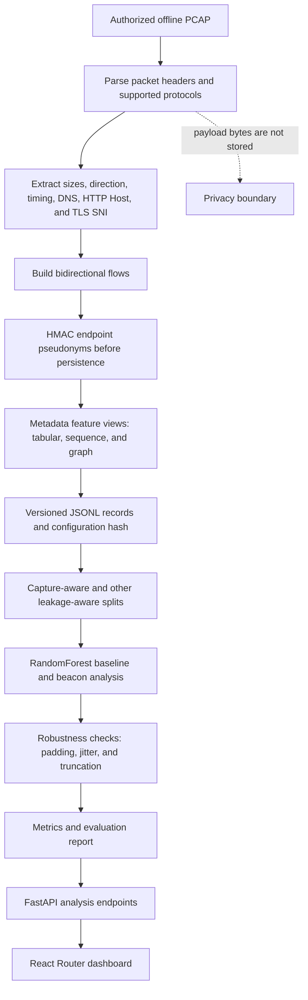

<p align="center">
  
</p>

<h1 align="center">CipherScope</h1>

**Understand encrypted network traffic from its shape, without ever decrypting it.**

CipherScope reads packet *metadata* (sizes, direction, timing, flow structure) from offline captures, turns it into features, and evaluates simple classifiers and a beacon detector the honest way: with leakage-aware splits, robustness tests and clear warnings about what the numbers do and don't prove.

---

## The problem

Most traffic is encrypted now, so defenders can't read payloads. What's left is metadata, and that's where research and tooling get shaky:

- **Privacy risk.** Working with raw captures means handling real IP addresses and ports, which can identify people and their browsing.
- **Inflated results.** Many traffic-classification demos split flows randomly. Flows from the same capture, host or session land on both sides of the split, so the model memorizes instead of generalizing and the accuracy looks great for the wrong reason.
- **Fragile models.** A classifier that works on clean traffic can fall apart when packets are padded, delayed or truncated, and few projects test for that.
- **Hard to reproduce.** Feature extraction settings are rarely recorded, so nobody can tell whether two results came from the same pipeline.

## What CipherScope does

| Area | What it does |
|------|--------------|
| **Ingestion** | Reads authorized offline PCAPs using only headers, flags, timestamps and frame lengths. Payload bytes are never parsed or saved. |
| **Privacy** | Endpoint addresses are HMAC-hashed before any flow record is written. Raw addresses and ports are never feature columns, and absolute timestamps never reach the model. |
| **Flows** | Builds bidirectional flows with idle and active timeouts. |
| **Features** | Tabular, sequence and graph-metadata views, plus a simple beacon detector for periodic callbacks. |
| **Storage** | Schema-versioned JSONL with a hash of the extraction config, so results trace back to the exact pipeline. |
| **Splits** | Five holdout strategies (random-flow caution, host, time, dataset, environment) to catch leakage. |
| **Model** | An explainable-by-feature RandomForest baseline. |
| **Evaluation** | Macro-F1, PR-AUC, ECE, FPR at a fixed recall, and robustness under padding, timing jitter and packet truncation. |
| **Serving** | Local FastAPI backend and a React Router dashboard for flow shapes and results. |

## Why it matters

- **Privacy by design.** Hashing happens at ingest, so the stored data never contains raw endpoints. That's the right default for anything touching real network data.
- **Honest evaluation.** Leakage-aware splits show how much of a "good" score is memorization. Reporting the random split only as a caution makes the gap visible instead of hiding it.
- **Robustness is measured, not assumed.** Padding, jitter and truncation tests show how quickly the signal degrades, which matters because real attackers and real networks do all three.
- **Reproducible.** Versioned records and a config hash make it possible to rerun and compare results.
- **A foundation to build on.** The pipeline is end to end (PCAP to dashboard), so better models and datasets can be dropped in without redoing the plumbing.

## Architecture and how it works

The pipeline uses authorized offline captures and only the observable metadata needed for flow analysis. It hashes endpoints before persistence, keeps absolute times out of model features, and evaluates with splits designed to reveal leakage.



Payload bytes are never decoded or saved. Scores from the bundled synthetic data only show that the workflow runs; they do not establish detection performance on real encrypted traffic.
## Getting started

**Requirements:** Python 3.11+, [uv](https://docs.astral.sh/uv/), Node.js 20+

```bash
uv sync --extra dev
uv run python -m cipherscope.datasets.synthetic --output data/demo_flows.jsonl
uv run python -m cipherscope.eval.runner
uv run uvicorn cipherscope.api.main:app --reload
```

In a second terminal:

```bash
cd dashboard
npm ci
npm run dev
```

Open <http://127.0.0.1:5173>. The comparison report is written to `output/reports/synthetic-evaluation.json`.

### Ingest your own authorized capture

```powershell
uv run python -m cipherscope.cli ingest-pcap .\capture.pcap `
  --capture-id office-lab-2026-10-11 --environment authorized-lab `
  --label benign --output data/flows.jsonl
```

The CLI never uploads capture files. Use explicit capture and environment IDs, and keep personal data out of labels.

### Docker (localhost only)

```powershell
Copy-Item .env.example .env
<p align="center">
  
</p>

# Replace the sample salt and admin token before using real authorized metadata
docker compose up --build
```

API on `127.0.0.1:8000`, dashboard on `127.0.0.1:5173`. The experiment endpoint requires an `X-Admin-Token` header matching `CIPHERSCOPE_ADMIN_TOKEN`.

### Verify

```bash
uv run pytest
uv run ruff check .
uv run python -m cipherscope.eval.runner
cd dashboard && npm ci && npm run build
```

## Project layout

```
cipherscope/
  ingest/        offline PCAP reader and CLI
  flows/         packet and flow records
  features/      tabular, sequence, graph and beacon views
  privacy/       keyed identifier hashing
  splits/        session, host, capture, time, dataset, environment holdouts
  models/        baseline training
  eval/          honest evaluation reports
  robustness/    padding, jitter and truncation transforms
  store/         schema-versioned JSONL output
  api/           flow, beacon, graph, model, drift, experiment, WebSocket endpoints
dashboard/       React Router UI
experiments/configs/   reproducible experiment parameters
output/reports/        generated reports (synthetic ones are git-ignored)
tests/                 privacy, feature, split, beacon and API checks
```

## Safety and privacy boundary

- Use only public research data, your own lab captures, or data you're authorized to process. Check each external dataset's license and known labeling issues first.
- CipherScope never decrypts or intercepts traffic.
- Don't profile individual browsing behavior. Set a retention period and rotate `CIPHERSCOPE_HASH_SALT` for real authorized datasets.
- The demo data is **synthetic**. Its metrics show the pipeline runs, not that it detects real threats.

## Current scope and limitations

This is an end-to-end learning MVP, not a finished research system.

- The classifier is a single tabular RandomForest. Sequence tensors and graph summaries are feature views, not trained deep-learning models.
- Not implemented yet: TLS ClientHello and DNS/QUIC parsing, Zeek, Parquet, MLflow, SHAP, live interface capture, probability calibration, a model registry.
- The drift endpoint intentionally reports `not_configured`.
- The demo report is not cross-dataset validation and shouldn't be presented as such.

Before drawing real-world conclusions: add licensed external datasets, clean duplicates and labels at capture level, run at least three seeds, calibrate on a training-only grouped validation set, and report cross-dataset results alongside failures and negative results.

## Author

**Nihal Machhi** · [GitHub](https://github.com/nihalmachhi)

