# Architecture

```mermaid
flowchart LR
  A[Authorized offline PCAP or Zeek conn.log] --> B[Headers, sizes, direction, timing only]
  B --> C[Bidirectional flow assembler]
  C --> D[HMAC endpoint pseudonyms]
  D --> E[Tabular, sequence and graph features]
  E --> F[Versioned JSONL]
  F --> G[Leakage-aware splits S1-S6]
  G --> H[Model zoo]
  H --> I[Metrics, bootstrap CIs, calibration, robustness]
  I --> J[Report with config hash and git SHA]
  J --> K[FastAPI + in-memory repository]
  K --> L[Dashboard / site]
```

## Components

- `ingest/`: PCAP, packet CSV and Zeek readers; flow assembly; CLI.
- `privacy/`: keyed hashing with fail-closed salt checks.
- `flows/`: `FlowRecord` schema and JSONL round trip.
- `features/`: tabular, sequence, graph and beacon views.
- `splits/`: six split strategies with group-disjoint assertions.
- `models/`: one interface over RandomForest, HistGradientBoosting, LogisticRegression and an optional 1D-CNN.
- `eval/`: config-driven runner, metrics, bootstrap and report metadata.
- `robustness/`: padding, jitter and truncation transforms.
- `drift/`: PSI and KS between time windows.
- `api/`: FastAPI app factory, lifespan, in-memory repository, routers, jobs.
- `store/`: JSONL and optional Parquet.